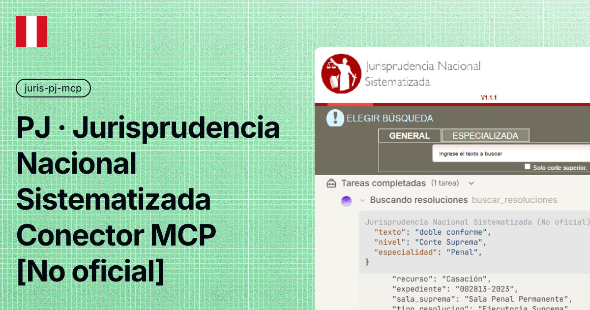

# Jurisprudencia Nacional Sistematizada (Conector MCP - No oficial)




Servidor MCP **local** para buscar y leer la **Jurisprudencia Nacional Sistematizada del Poder Judicial del Perú** (casaciones, apelaciones, ejecutorias supremas, sentencias de vista, autos y laudos arbitrales) desde tu harness MCP. Conexión directa con httpx: **sin navegador, sin playwright y sin credenciales**.

> Herramienta **no oficial**: sin afiliación con el Poder Judicial del Perú ni con ninguna entidad del Estado peruano. Ver [Aviso legal](#aviso-legal).

| | |
|---|---|
| Fuente de datos | [jurisprudencia.pj.gob.pe](https://jurisprudencia.pj.gob.pe/jurisprudenciaweb/faces/page/inicio.xhtml) (público) |
| Autenticación | Ninguna: usa la misma sesión anónima del portal (JSF) y la renueva sola |
| Almacenamiento | **Ninguno** — el servidor nunca guarda archivos: los PDFs se entregan como URL pública y el Excel como base64 con cap declarado |
| Transporte | stdio (Claude Desktop, Claude Code, agentes compatibles con MCP) |
| Herramientas | 10 |

## Corpus (aproximado)

| Métrica | Valor |
|---|---|
| **Corpus total del portal** | **≈687.770 resoluciones** (lecturas del 15/10/2026) |
| Cómo se mide | contador del propio portal: *"De un total de N resoluciones, se obtuvieron M resultados"* (observado 687.769–687.771 en páginas distintas) |
| Qué incluye | resoluciones sistematizadas de Corte Suprema y Cortes Superiores de todas las especialidades; los laudos arbitrales viven en el buscador aparte 'Comerciales' (ej. «anulación del laudo» ≈3.100) |

## Instalación

### Opción A — Un click (sin terminal)

1. Descarga **`juris-pj-mcp.mcpb`** desde [Releases](https://github.com/pipaacebedo/juris-pj-mcp/releases/latest) (asset con nombre fijo: siempre es el mismo archivo, actualizado a la última versión).
2. Abre Claude Desktop → **Ajustes → Extensiones → Instalar desde archivo**.
3. Selecciona el `.mcpb` y listo.

> No requiere Python instalado: el instalador resuelve el runtime y las dependencias automáticamente (runtime UV de MCPB).

### Opción B — Manual (CLI y otros agentes)

Primero instala [uv](https://docs.astral.sh/uv/) si no lo tienes:

```powershell
# Windows (PowerShell)
irm https://astral.sh/uv/install.ps1 | iex
```

```bash
# macOS / Linux
curl -LsSf https://astral.sh/uv/install.sh | sh
```

Luego, en la carpeta del proyecto:

```bash
uv sync
```

Y añade a la configuración de servidores MCP de tu agente:

```json
{
  "mcpServers": {
    "juris-pj-mcp": {
      "command": "uv",
      "args": ["run", "--directory", "{ruta}/juris-pj-mcp-oss", "server.py"]
    }
  }
}
```

> Reemplaza `{ruta}` por la carpeta local donde dejaste el proyecto (ej. `C:/mcp` en Windows o `/opt/mcp` en Linux/macOS).

El servidor envía sus instrucciones de uso por el handshake MCP: el agente sabe cómo buscar y leer sin prompts adicionales.

## Actualizaciones

- El servidor se auto-chequea en cada arranque: si publicamos una versión más nueva que la tuya, tu agente verá el aviso `UPDATE DISPONIBLE` y te pedirá descargar `juris-pj-mcp.mcpb` de [Releases](https://github.com/pipaacebedo/juris-pj-mcp/releases/latest) e instalarlo de nuevo (arrástralo como la primera vez). Se desactiva con `PJ_UPDATE_CHECK=0`.
- Cada versión reemplaza el mismo archivo (`juris-pj-mcp.mcpb`): la página de Releases siempre muestra una sola tarjeta con la última.

## Tools

| Tool | Qué hace |
|---|---|
| `buscar_resoluciones` | Búsqueda con todos los filtros del buscador público: texto, nivel (Suprema/Superior), distrito + sala (dependientes), especialidad, pretensión/delito y palabras clave (match EXACTO), expediente, tipo de recurso/resolución, año (1998-2026 + 1982), NCPP/NLPT, autos y orden × forma. Paginación por `index` GLOBAL 0-based continuo; `paginas` 1..6 en una sola llamada |
| `buscar_laudos` | Buscador aparte de anulación/ejecución de laudos arbitrales ('Comerciales'): texto, año, expediente, palabra clave y orden/forma honrados |
| `ficha_resolucion` | Ficha/resumen por `index`: sumilla COMPLETA, palabras clave, sala suprema u órgano y `url_pdf` |
| `fichas_resoluciones` | Lote de fichas de la MISMA búsqueda en una llamada (cap 50; fallidos a `faltas` con motivo) |
| `url_resolucion` | URL pública del PDF por `uuid` (formato validado localmente) |
| `exportar_excel` | XLS de la búsqueda completa en base64 (cap 12 MB declarado; si lo supera: `ok:false` con tamaños, NUNCA truncado) |
| `buscar_pretensiones` | Autocomplete de Pretensión/Delito (valores EXACTOS para el filtro) |
| `buscar_palabras_clave` | Autocomplete de Palabras Clave (valores EXACTOS) |
| `listar_salas` | Salas de un distrito y especialidad de corte superior (cadena dependiente real; cache 30 min) |
| `listar_filtros` | Catálogos exactos: nivel, distritos, especialidades, tipos_recurso, tipos_resolucion, años y orden |

## Cómo se busca (3 niveles)

1. **Descubrir** — `buscar_resoluciones` / `buscar_laudos`: filas con `index` GLOBAL (0-based y continuo entre páginas), sumilla COMPLETA, `uuid` + `url_pdf` y un `ses` para continuar. Con SOLO texto se reproduce la búsqueda del home (el conjunto MÁS amplio que entrega el portal); al agregar filtros el sitio refina como en su UI; los filtros SOLOS también son válidos (cualquier combinación, sin texto).
2. **Detalle** — `ficha_resolucion(ses, index)` para una resolución; `fichas_resoluciones(ses, indices)` para lotes.
3. **Documentos** — `url_resolucion(uuid)` entrega la URL pública del PDF (descarga directa contra el portal) y `exportar_excel(ses)` el XLS completo de la búsqueda.

Los valores EXACTOS de los filtros salen de `listar_filtros`, `buscar_pretensiones`, `buscar_palabras_clave` y `listar_salas`: no hay que adivinarlos.

## Semántica y validaciones estrictas

- **Sesiones `ses`**: TTL de 15 min deslizante (cada uso renueva) y LRU. Cambiar filtros con el mismo `ses` re-ejecuta conservando el id; un `ses` desconocido con filtros arranca una búsqueda NUEVA y lo declara en `nota`.
- **Índice GLOBAL**: 0-based y continuo entre páginas (el portal sirve 10 filas por página); `paginas` 1..6 trae páginas consecutivas en UNA llamada (con `nota` de recorte). Una `pagina=N` fuera de rango responde **instantánea** (ms≈0, sin red) con el total.
- **Match EXACTO de catálogos**: `'Penal'` no cae en `'Familia Penal'`; `'Nulidad'` no cae en `'Recurso de Nulidad'`; `'Laboral'` no arrastra `'Contencioso Adm. Laboral'`.
- **`orden` por etiqueta o código**: `'Nro de Recurso'` == `'0'` (las etiquetas del catálogo funcionan); inválidos → `{ok:false}` con la lista, sin fallback silencioso. Ídem `forma` (`ASC`/`DESC`).
- **`sala` validada server-side** contra el combo del distrito/especialidad: una sala inexistente devuelve `{ok:false}` con ejemplos (JAMÁS un filtrado silencioso con el universo entero). `'Todos'`/`'0'` equivalen a no filtrar en distrito, sala y año.
- **Coherencia total↔filas**: si un refino queda sin resultados, `filas` vuelve vacío con `total:0` y `nota` (nunca arrastra filas del landing anterior).
- **Campos**: la clave llega SIEMPRE que el sitio publique el label en ESA fila (`""` si lo publica vacío); si no lo publica, se omite (nada se inventa). Las **sumillas llegan COMPLETAS**: el servidor nunca trunca datos.
- **Contrato cerrado**: cada tool publica `additionalProperties:false` — los argumentos listados son los únicos (no hay `materia` ni `tamano_pagina` fantasma).
- Toda respuesta trae **`ms`** (latencia real del servidor) y los errores son siempre `{ok:false, error, pista}` con una pista accionable (catálogos, ejemplos, reintento).

## Flujo recomendado para el agente

1. `buscar_resoluciones(texto='...')` o con filtros exactos (de las tools de catálogo).
2. Página siguiente: re-llama con el mismo `ses` y `pagina=N` sin cambiar filtros.
3. `ficha_resolucion(ses, index)` para el resumen, `url_resolucion(uuid)` para el PDF y `exportar_excel(ses)` para el XLS.
4. `buscar_laudos(...)` es un buscador aparte (su `ses` es del buscador de laudos).

## Rendimiento (medido, no prometido)

El portal del PJ es lento e intermitente: aterrizaje 9-18 s (hasta ~60 s en horas pico), POST de filtros 2-8 s, cada página paginada 8-12 s (hasta ~30 s), PDF 4-17 s, `listar_salas` ~15-35 s la primera vez (después cache 30 min). Por eso:

- Prefiere 1 llamada con `paginas=3..6` (hasta 60 filas) a varias llamadas de 1 página.
- Las llamadas con `paginas` 4-6 pueden tardar 60-100 s (y hasta ~300 s si el portal se atasca): usa `paginas` 1-3 si necesitas latencias menores.
- Watchdog `PJ_TOOL_TIMEOUT` (300 s) + reintento×1: si el socket del portal se cuelga, la tool responde con error y pista — nunca un hang. **El servidor es el único dueño del timeout**: configura el techo de petición de tu cliente MCP en **≥310 s** — un corte del cliente (p. ej. `-32001 Request timed out`) no es una falla del servidor (la llamada seguía en curso) y no conviene reintentar a ciegas con los mismos argumentos.
- Cortesía con la fuente: semáforo de concurrencia y sesiones LRU; los PDFs y el Excel se piden al portal solo cuando el agente los necesita.

## Limitaciones y diseño (particularidades del portal)

- La ficha popup "Ver" del portal (resoluciones relacionadas del expediente) queda vacía o cuelga sin navegador: toda la data estable (sumilla, sala, expediente, uuid) vive en la fila y se expone completa.
- Los buscadores "por Normas" y "por Juez Supremo" no se pueden poblar sin el JS del sitio: no hay tools para ellos.
- El autocomplete de Pretensión/Delito especializado de la Corte Suprema siempre devuelve vacío → el filtro `pretension` aplica en Corte Suprema (como en la web).
- El portal sirve SIEMPRE 10 filas por página (verificado): no existe `tamano_pagina`; usa `paginas` para leer más de una página por llamada.
- Las filas de Corte Suprema publican `sala_suprema`/`norma_derecho_interno` en lugar de `especialidad`/`organo_jurisdiccional` (son el mismo nivel de datos, alternados por el sitio según el nivel).
- Inestabilidad upstream: los HTTP 500 y micro-cortes del PJ se traducen a `{ok:false, error, pista}` reintentables (es el portal, no el servidor).

## Variables de entorno (opcionales)

| Variable | Default | Para qué |
|---|---|---|
| `PJ_TIMEOUT` | `240` | Timeout HTTP (read/connect) por request; deja ventana al reintento ×1 bajo el watchdog |
| `PJ_TOOL_TIMEOUT` | `300` | Watchdog por tool (5 min máx): toda tool responde aunque el portal cuelgue |
| `PJ_VERIFY` | `1` | Validación TLS del portal (`0` si tu red la interfiere) |
| `PJ_MAX_CONCURRENCY` | `2` | Requests simultáneos hacia el portal |
| `PJ_INFLIGHT_CAP` | `8` | Tope global de requests en vuelo |
| `PJ_SESION_TTL` | `900` | TTL deslizante de las sesiones (segundos) |
| `PJ_SESION_MAX` | `10` | Máximo de sesiones vivas (LRU) |
| `PJ_EXCEL_MAX_MB` | `12` | Cap del Excel en base64 |

## Aviso legal

- Proyecto independiente, **no oficial**, sin relación con el Poder Judicial del Perú ni con ninguna entidad del Estado peruano.
- Provisto **tal cual**; sin garantía de disponibilidad del portal ni de exactitud de los datos. Para uso jurídico serio, verifica siempre en la fuente oficial.
- Los datos son de acceso público en jurisprudencia.pj.gob.pe; respeta la fuente: no la uses para scraping masivo.

## Licencia

[Apache-2.0](LICENSE)
